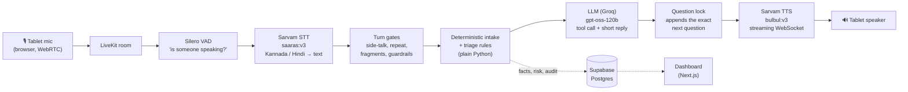

<p align="center">
  
</p>

<h1 align="center">Sakhi (ಸಖಿ)</h1>
<p align="center"><b>A voice companion that helps village health workers screen pregnant women - in Kannada and Hindi.</b></p>

---

## The story

It is ten in the morning in a village in Bidar district, in northern Karnataka.
Lakshmi is an **ASHA** - an *Accredited Social Health Activist*, one of about a
million women across India who are the health system's first and often only
contact with rural families. Today she is sitting on a mat in a small house,
next to a young woman who is six months pregnant.

Lakshmi has a checklist to get through: the mother's age, how far along she is,
her blood pressure, whether she has headaches or swelling or bleeding, whether
the baby is moving, whether she is taking her iron tablets, whether she knows
how to reach a hospital when labour starts. Missing one of those questions can
mean missing **pre-eclampsia** - high blood pressure in pregnancy, one of the
leading causes of maternal death - until it is an emergency.

Lakshmi does not need another form to fill in on a phone. She needs someone
patient to walk through the checklist with her, in her own language, while her
hands and eyes stay on the mother.

That is **Sakhi** - the word means *a woman's close friend*. Lakshmi opens a
page on her tablet and taps one button. Sakhi greets her in Kannada and asks the
first question out loud. Lakshmi answers the way she would answer a colleague -
*"ಹೆಸರು ಪ್ರಿಯಾ, ವಯಸ್ಸು ಇಪ್ಪತ್ತೆಂಟು"* ("her name is Priya, she's twenty-eight").
Sakhi confirms it and moves on. About a second and a half after Lakshmi stops
speaking, Sakhi is already answering.

Twenty-odd questions later the visit is recorded, a risk level has been worked
out by rules a doctor can read, and a summary sits on a dashboard for the
primary health centre. If anything on the way sounded dangerous - a blood
pressure of 160/110, fits, heavy bleeding - Sakhi stops the checklist, tells
Lakshmi calmly what to do *right now*, and offers to connect a specialist.

### What Sakhi is - and is not

- **Sakhi is a guide and a scribe.** It asks the standard antenatal questions in
  a fixed order, listens, records the answers, and applies published danger-sign
  rules.
- **Sakhi is not a doctor.** It never prescribes, never names a dose, never
  diagnoses. When asked "which tablet should I give her?", it says it cannot
  advise on medicines and points to the doctor. This is enforced in code, not
  just asked for in a prompt.
- **The code decides; the model only talks.** Which question comes next, whether
  an answer is valid, and how risky a reading is are all decided by plain,
  testable Python. The language model's job is narrow: understand Lakshmi's
  reply, call the right recording tool, and say a short, warm acknowledgement.

---

## How a conversation actually works

Every time Lakshmi speaks, her voice goes through the same chain. This is what
happens in the roughly 1.5 seconds between her last word and Sakhi's first word:



Step by step, with the numbers we measured on the production server
(synthetic calls, September 2026):

| # | Stage | What it does | Typical time |
|---|-------|--------------|--------------|
| 1 | **Microphone → LiveKit** | The tablet's browser sends audio over WebRTC to a LiveKit room. A Python worker has joined the same room as the "agent". | network |
| 2 | **Voice activity detection** | Silero VAD decides when Lakshmi starts and stops talking. A second, gentler VAD cuts the audio into whole utterances so a pause for breath does not split "twenty-eight" into "twenty" and "eight". | ~0.4-0.6 s of silence |
| 3 | **Speech → text** | Each complete utterance is sent to Sarvam's `saaras:v3` model (REST, `transcribe` mode, Kannada script out). Quiet audio is gain-normalised first. | 0.25-0.43 s |
| 4 | **Turn gates** | Is she talking to the mother, not to Sakhi? Is it just "hmm"? Is it half a sentence? Is it a request for medicine advice or an attempt to jailbreak? Each gate can hold the turn - but never drops one that contains a number, a symptom or a yes/no. | < 5 ms |
| 5 | **Deterministic intake and triage** | Numbers, names, gestational age, gravida, BP and danger signs are extracted by rules (with Kannada and Hindi number words and negation handling). The answer is validated for the *type* of question that was asked. Risk is computed by `sakhi_triage.py`. | < 5 ms |
| 6 | **Language model** | Groq-hosted `gpt-oss-120b` (with a fallback chain) sees a short context and the list of recording tools. It calls the tool for the answer and writes a one-sentence acknowledgement. | first token ~0.6 s |
| 7 | **Question lock** | Sakhi must never paraphrase a clinical question into a different one, or invent one. The code strips any question the model wrote and appends the next checklist question word-for-word. | < 1 ms |
| 8 | **Text → speech** | Sarvam `bulbul:v3` synthesises Kannada/Hindi speech over a streaming WebSocket, clause by clause. | first audio 0.40-0.52 s |

Measured end to end: **Sakhi's reply was fully spoken about 1.4 s after the
final transcript** of Lakshmi's answer.

---

## The questionnaire: a wireframe, not a prompt

The 24 questions follow a primary-care *Antenatal Quick Check* in seven stages:
identity → obstetric history → vitals → red-flag screening → scans and
vaccinations → birth preparedness → close. They live in
[`sakhi_intake.py`](sakhi_intake.py) as a frozen tuple of `IntakeQuestion`
objects, each with its Kannada text, Hindi text, a pacing hint (`FAST` for
yes/no, `SLOW` for open answers) and, where needed, a rule for when it applies
(the last-period date, for example, is only asked when the gestational age is
still unknown).

`IntakeProgress` is a small state machine: exactly one question is *armed* at a
time, only that question can be closed, and only by an answer that fits its
type:

- **BP and weight** need a number, a unit, or an explicit "not measured yet".
- **Yes/no questions** accept polarity words and Kannada/Hindi verb endings
  ("ಇಲ್ಲ", "ತಿನ್ನುತ್ತಿದ್ದಾಳೆ", "नहीं है"), numbers, symptoms, or the
  question's own words ("ತಾಲೂಕು ಆಸ್ಪತ್ರೆಯಲ್ಲಿ" to "where was the scan done?").
- **Anything else** needs at least one real word after fillers and greetings
  ("ಅಕ್ಕ", "ನಮಸ್ಕಾರ") are removed. Latin-script text with no clinical content -
  noise that speech-to-text sometimes invents - is rejected.

If an answer is unclear twice in a row, the third attempt closes the question
as *"unclear, best-effort"* so the visit can never get stuck in a loop, and the
audit trail shows exactly which answer was weak.

## Safety, in layers

Sakhi talks about pregnant women's health, so safety is designed as several
independent layers rather than one clever prompt:

1. **Danger signs are detected by code.** [`sakhi_domain.py`](sakhi_domain.py)
   recognises bleeding, convulsions ("ಫಿಟ್ಸ್"), severe headache, blurred vision,
   swelling, reduced foetal movement, fever and more, in Kannada, Hindi and
   English. It is negation-aware in both directions ("ಫಿಟ್ಸ್ ಬಂದಿಲ್ಲ" = no fits;
   "no fits"), stops at clause boundaries so *"no headache, **but** she had fits"*
   still flags the fits, and a symptom followed by "it happened" (ಬಂತು, है)
   counts as present even if another symptom was denied nearby.
2. **Triage is a readable rule table.** [`sakhi_triage.py`](sakhi_triage.py)
   turns blood pressure, symptoms and gestational age into `ROUTINE`,
   `MODERATE` or `HIGH_RISK` with written reasons. A danger sign can escalate
   the call on its own; the model cannot talk its way out of it.
3. **Guardrails run before and after the model.** [`guardrails.py`](guardrails.py)
   redacts personal numbers (Aadhaar, phone) before anything is logged or sent
   to a model, refuses medicine and dosage requests in all three languages
   while still accepting factual answers like "she has had both tetanus doses",
   and blocks prompt-injection and SQL-probing attempts.
4. **The model never owns the flow.** The question lock, the typed answer
   validation and the end-of-call guard (Sakhi cannot say goodbye while
   questions remain) are all enforced outside the model.
5. **Pre-speech checks.** Before any sentence is spoken, `tts_node` checks that
   Sakhi is not claiming to have saved something that was never saved.

## Language

The pilot speaks **Kannada and Hindi only**. English is switched off
(`SAKHI_ENGLISH_ENABLED=false`) because the people using it do not need it and a
single English sentence mid-call is confusing. Every scripted line - greeting,
questions, danger-sign advice, refusals, goodbye - has a hand-written Kannada
and Hindi version; speech-to-text returns Kannada script, and a normaliser turns
spoken number words ("ಇಪ್ಪತ್ತೆಂಟು", "ಐವತ್ನಾಲ್ಕು", "नब्बे") into digits before
any rule sees them.

---

## Tech stack

| Layer | Technology | Where |
|-------|-----------|-------|
| Real-time audio | [LiveKit](https://livekit.io) Cloud rooms, `livekit-agents` 1.6 (Python) | `agent.py` |
| Voice activity / turns | Silero VAD, LiveKit multilingual turn detector, an adaptive endpointing controller | `agent.py`, `sakhi_pacing.py` |
| Speech-to-text | Sarvam AI `saaras:v3` (REST, per utterance); Deepgram as fallback | `sarvam_wrappers.py` |
| Language model | Groq `gpt-oss-120b` / `gpt-oss-20b` across two keys, OpenRouter as last resort, wrapped in LiveKit's `FallbackAdapter` with hedging | `agent.py`, `llm_hedge.py` |
| Text-to-speech | Sarvam AI `bulbul:v3` over a streaming WebSocket, with a disk cache for repeated clauses and a pre-rendered greeting | `sarvam_wrappers.py`, `tts_audio_cache.py` |
| Clinical logic | Intake state machine, danger-sign detection, triage rules, question lock | `sakhi_intake.py`, `sakhi_domain.py`, `sakhi_triage.py`, `sakhi_question_lock.py` |
| Safety | Local guardrails (PII redaction, medication, jailbreak, SQL) | `guardrails.py` |
| Storage | Supabase Postgres (private `sakhi` schema, RLS on, dedicated runtime role) via `psycopg` 3 connection pool; SQLite for tests and offline work | `sakhi_sql_repository.py`, `sakhi_schema.py` |
| Telemetry | Per-turn latency, component health, pipeline event log (JSONL + Postgres) | `sakhi_telemetry.py`, `status_server.py` |
| Web app | Next.js 16, React 19, LiveKit Components, Tailwind 4 | `frontend/` |
| Hosting | AWS EC2 (ap-south-1), nginx with TLS, systemd; deploys staged through S3 and run with SSM | `deploy/aws/` |

### The web app

- **`/` - the ASHA console.** One big button to start a visit, a language
  switch (Kannada / Hindi), a live transcript, a microphone health notice, and a
  visit summary card at the end.
- **`/admin` - the engineering dashboard.** Every call's pipeline drawn as
  stages - microphone, LiveKit, STT, turn, LLM, TTS, database - each green,
  amber or red, so a person on call can see *which part* broke without reading
  logs. Plus recent calls, risk flags and per-turn latency.
- **`/reports` - visit reports** for the health centre: the mother, her
  readings, the risk level with reasons, and what was flagged for a doctor.

### Data model

Eight tables in a private Postgres schema (`sakhi`): `mothers`, `bp_records`,
`symptom_records`, `teleconsults`, `call_reports`, `call_turns`,
`pipeline_events`, `component_health`. The schema is created by the worker
itself on start-up ([`sakhi_schema.py`](sakhi_schema.py) writes the same DDL for
SQLite and Postgres), so a new environment needs only a connection string. The
schema is not exposed to Supabase's public Data API, row-level security is on,
and [`deploy/supabase/`](deploy/supabase/) holds the optional tenant-isolation
migration.

---

## Repository map

```
agent.py                 the LiveKit worker: session wiring, turn gates, llm_node / tts_node
sakhi_intake.py          the 24-question wireframe and IntakeProgress state machine
sakhi_domain.py          call state, danger-sign / number / gestational-age extraction
sakhi_triage.py          risk rules (ROUTINE / MODERATE / HIGH_RISK) with reasons
sakhi_question_lock.py   keeps the model from rewording or inventing questions
sakhi_tools.py           the recording tools the model may call
sakhi_prompts.py         system prompts (Kannada, Hindi)
guardrails.py            PII redaction, medication / jailbreak / SQL refusals
clinical_terms.py        Kannada/Hindi number words and clinical vocabulary
sarvam_wrappers.py       Sarvam STT (REST + socket) and TTS (REST + streaming)
tts_audio_cache.py       disk cache for repeated TTS clauses
sakhi_sql_repository.py  Postgres / SQLite repositories (psycopg pool)
sakhi_telemetry.py       latency + component health writer
status_server.py         small HTTP surface for health and logs
frontend/                Next.js console, dashboard and reports
deploy/aws/              EC2 provisioning, secrets push, gated deploy, nginx, systemd
deploy/supabase/         optional SQL migration (tenant RLS, pgvector)
scripts/                 end-to-end call probe, STT accuracy probe, live-LLM scenarios
tests/                   ~1,500 tests: clinical rules, languages, safety, pipeline
docs/                    engineering write-ups (e.g. the STT fragmentation incident)
```

## Running it yourself

You need accounts for LiveKit, Sarvam AI and Groq (Supabase is optional -
without `DATABASE_URL` Sakhi uses a local SQLite file).

```bash
python -m venv .venv && source .venv/bin/activate
pip install -r requirements.txt
cp .env.example .env          # fill in LIVEKIT_*, SARVAM_API_KEY, GROQ_API_KEYS
python agent.py download-files
python agent.py dev           # starts the worker and registers it with LiveKit
```

```bash
cd frontend
npm ci
npm run dev                   # http://localhost:3000
```

Run the tests (no network or keys needed):

```bash
python -m pytest tests -q
```

`scripts/e2e_call_probe.py` joins a real LiveKit room as a synthetic caller and
plays a recorded answer as the microphone - the closest thing to a real call
without a person. `scripts/live_llm_scenarios.py` drives full conversations
through the real model in text mode.

## How we build it

A few habits run through the whole codebase:

- **Measure before changing.** Every latency or accuracy claim in this README
  came from a probe run on the production host. When speech-to-text was
  splitting "ಇಪ್ಪತ್ತೆಂಟು" (28) into two numbers, we measured 0/10 correct
  transcripts before the fix and 49/50 after - see
  [`docs/STT_FRAGMENTATION_INCIDENT.md`](docs/STT_FRAGMENTATION_INCIDENT.md).
- **Every production bug becomes a test.** Real calls that went wrong -
  a "never diagnosed with fits" answer read as convulsions, a tetanus-dose
  answer refused as medical advice, a call that would not end after the last
  question - each has a test named after it.
- **Gated deploys.** A release is compiled, imported and exercised against the
  live speech and voice services on a scratch copy on the server, then a full
  scripted visit is run through the real model - and only then swapped in,
  with an automatic rollback if the worker does not come back.

## Honest limits

- It is a **pilot**. The Hindi question texts and several Kannada scripts still
  need sign-off from native-speaker clinicians.
- Speech recognition in a noisy courtyard is still the weakest link; Sakhi
  asks again rather than guessing, and after two unclear answers it records
  the best effort and flags it.
- The model's acknowledgements are generated. The *questions*, *risk levels*
  and *safety responses* are not.
- Sakhi supports, and never replaces, the ASHA worker's judgement and the
  doctor's decision.

---

<p align="center"><i>Built for the ASHA workers of Karnataka - and for every mother they walk to see.</i></p>
